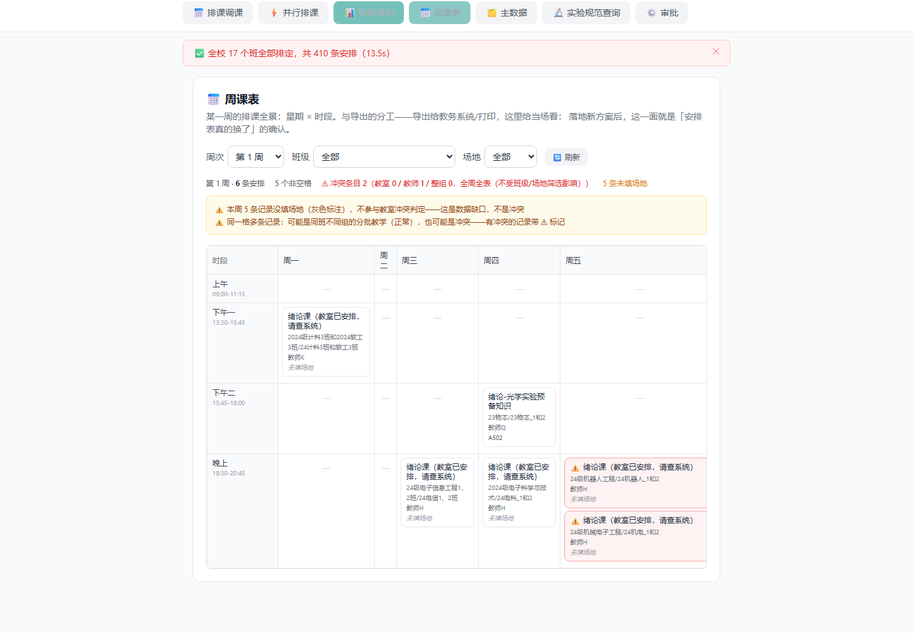
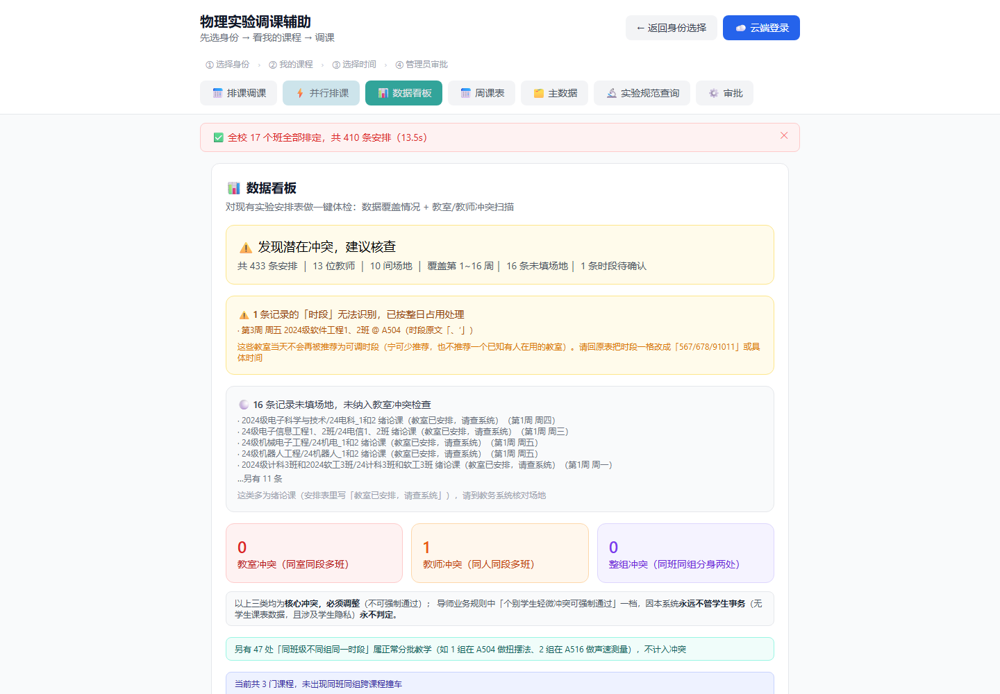
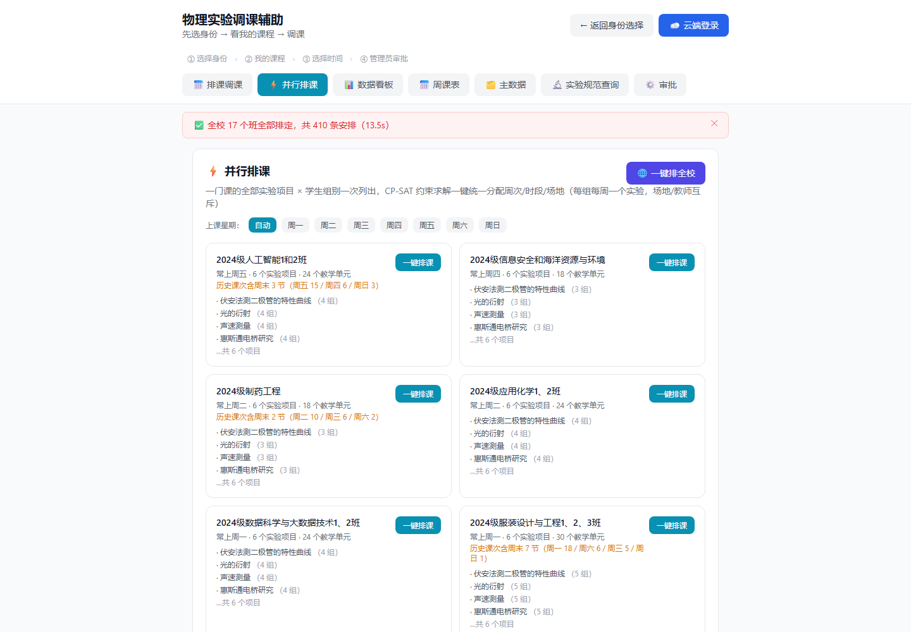

# 物理学科智能排课选课智能体系统

> 面向高校物理实验教学的智能辅助系统：排课、并行批量排课、主数据管理、调课、实验规范查询。

[English README](README.md)

---

## 项目简介

面向大学物理实验教学场景的**三大模块智能体系统**：**排课、调课、实验规范查询**
（排课模块含并行批量排课、全校一键排课、主数据管理、方案落地、周课表网格可视化、数据体检、教务标准课表导出）：

| 模块 | 能力 |
|------|------|
| 📅 **排课** | 约束求解自动排课、冲突检测、候选方案推荐 |
| ⚡ **并行批量排课** | CP-SAT 一次求解一个班的「全部实验项目 × 学生组别」（导师座谈一号痛点）；缺教师/场地信息自动灰箱补全，且每个代做决定都说出口 |
| 🗂️ **主数据管理** | 课程/实验项目/教师/场地/班级五张实体表可增删改，从安排表反推、重启不丢（版本化落盘）、可导出 Excel 台账并导回 |
| 🔄 **调课** | 模板 + 自然语言双入口，冲突分级（场地/教师/整班同组），管理员审批真正落到课表 |
| 🔬 **实验规范查询** | 排课人员/教师查询实验项目的学时、场地、操作步骤、数据处理与报告规范 |

**设计原则**：规则引擎保证排课正确（冲突筛选），LLM 增强体验（意图解析、候选方案、咨询问答）。

## 界面预览

以下截图使用**脱敏数据**（教师显示为「教师A/B/C…」，无姓名、无联系方式、无学生个体数据），均可公开。

**周课表冲突可视化** —— 任一周的「星期 × 时段」全景，冲突格带 ⚠ 标记：



**数据看板** —— 一键体检，扫描教室 / 教师 / 整组三类核心冲突，并对「时段识别失败」「未填场地」等数据质量缺口单列说明：



**并行批量排课** —— 一门课的「全部实验项目 × 学生组别」用 CP-SAT 一次求解，按班级列出项目与分组：



## 为什么做这个项目

- 论文调研表明：实验课很少进入高校排课系统，排课依赖人工协调
- 一处调整可能引发多班、多教师、多实验室的连锁冲突
- 现有工具（Excel、问学委）无法高效解决跨班跨教师冲突

## 技术栈

| 层 | 技术 |
|----|------|
| 后端 | Python FastAPI + openpyxl + **OR-Tools CP-SAT**（`requirements.txt` 中为 `ortools`） |
| 前端 | React + Vite + TypeScript + Tailwind CSS |
| LLM | 律动基元（OpenAI 兼容，环境变量可替换） |
| 数据 | 实验安排表（433条）+ 五表主数据（不含任何学生数据） |

## 快速启动

### 环境要求

- Python 3.10+
- Node.js 18+
- **LLM 凭据（任选其一，按以下优先级自动探测）**：

| 优先级 | 环境变量 | 说明 |
|---:|---|---|
| 1 | `ZHIPU_API_KEY` | 永久免费不限量（主防线） |
| 2 | `MODELSCOPE_API_KEY` | 免费 2000 次/天，热门时段可能 429 |
| 3 | `TOKENHUB_API_KEY` | 一次性体验包，额度用尽报 402 |
| 4 | `DEEPSEEK_API_KEY` | 余额制（付费） |
| 5 | `AMD_API_KEY` / `XFYUN_API_KEY` | 免费档，有速率限制 |
| — | `JIYUAN_LVDONG_API_KEY` | ⚠️ **已欠费 402，仅历史兜底，勿用** |

> 只设其中一个即可；都未设时会自动按上表顺序探测（`app/agent/llm_intent_parser.py::_AUTO_ORDER`）。
> **不配 LLM 也能用**：规则引擎承担全部排课逻辑，LLM 只增强意图解析与咨询问答，
> 缺失时相关功能降级为规则解析（设 `LLM_DISABLED=1` 可显式关闭）。

### 后端

```bash
cd backend
pip install -r requirements.txt
uvicorn app.main:app --host 0.0.0.0 --port 8000
```

### 前端

```bash
cd frontend
npm install
npm run dev
```

打开 **http://localhost:5173**

## 使用流程

1. **选择身份**——点击教师卡片（系统知道用户是谁）
2. **我的课程**——查看全部课程，标注可调/不可调
3. **模板调课**——选课程 + 目标周次，自动冲突筛选
4. **结果**——绿色可用时段 + 灰色被排除时段（附原因）+ AI 候选方案
5. **提交**——生成调课申请
6. **管理员审批**——同意/驳回（需管理员登录）
7. **实验规范查询**——面向排课人员/教师的实验规范问答

## 核心设计决策

这个项目有一条贯穿始终的原则：**规则引擎保证正确性，大模型只增强体验，LLM 输出永不直接改动排课数据**。

具体体现为四条：

1. **冲突判定不交给 LLM**。场地 / 教师 / 同班同组三类核心冲突由规则引擎判定，判据按 (班级, 组) 粒度——真实表里 47 处合法的并行教学（同一时段多组同时上课）因此**零误报**。LLM 只负责解析自然语言意图和生成候选方案，它的建议必须经规则引擎过滤后才呈现。

2. **求解器只排"该排的东西"**。绪论课、考试类项目登记在主数据里、界面可见，但**永不进入 CP-SAT 求解器**——它们不是需要安排时段的教学单元。这是一条显式过滤器，不是靠数据清洗规避。

3. **缺信息时不静默猜测**。并行批量排课的灰箱模式会自动补全缺失的教师（按负载最轻优先）/ 场地 / 周次，但**每一条假设都会逐项报告给用户**，用户看得见系统替他做了什么决定。

4. **写操作可回溯**。方案落地经"差异预览 → 管理员采纳 → 写回 → 可撤销 → 重启重放"五步，每一步落盘，任何时候能回到采纳前的快照。

## 核心功能

- ✅ **冲突分级**：核心冲突（场地/教师/同班同组）说清「撞了什么、该怎么改」
- ✅ **并行批量排课**：整班 CP-SAT 一次求解（一个班的所有实验 × 所有学生组），灰箱模式自动补全并报告假设
- ✅ **主数据一等公民**：五张实体表反推后可编辑，重启自愈；绪论/考试类登记在册但**绝不进求解器**
- ✅ **台账往返**：五张表导出 Excel → 离线维护 → 导回，带统计列伪装与班名切碎两道防线
- ✅ **自然语言调课**：「我是吴琳，第六周的课上不了，调到下周」，信息缺失时系统主动多轮追问
- ✅ **方案落地**：全校一键方案先看四类差异账，管理员采纳后写回安排表，可随时撤销、重启自动重放
- ✅ **周课表可视化**：某一周的 星期 × 时段 全景网格，冲突格带标记

## 项目结构

```
physics-scheduler-agent/
├── backend/
│   ├── app/
│   │   ├── main.py                 # FastAPI 入口
│   │   ├── api/reschedule.py       # API 端点
│   │   ├── master_data.py          # 五表主数据（反推 + CRUD）
│   │   ├── master_store.py         # 主数据版本化落盘
│   │   ├── master_workbook.py      # 台账导出/导回（往返）
│   │   ├── conflict_model.py       # 冲突分级（核心三类）
│   │   ├── course_bridge.py        # 课程归属 + 跨课程撞车扫描
│   │   ├── agent/                  # 调课智能体、LLM 意图解析
│   │   ├── engine/                 # 约束求解自动排课（CP-SAT）
│   │   └── utils/                  # Excel 解析器 / 时间模型
│   └── tests/                      # pytest 测试套件
├── frontend/
│   └── src/                        # React 界面（看板/主数据/并行排课/沙盘等）
├── scripts/                        # 独立审计器 + 发布预检
├── docs/                           # PRD、架构、使用指南、总结反思
└── start.ps1 / start.bat           # 一键启动
```

## API 一览

| 方法 | 路径 | 模块 | 说明 |
|------|------|------|------|
| POST | `/api/reschedule/upload` | 排课 | 上传实验安排表 |
| GET | `/api/reschedule/teachers` | 排课 | 教师列表（身份选择） |
| GET | `/api/reschedule/teachers/{name}/courses` | 排课 | 教师课程 |
| POST | `/api/reschedule/auto-schedule` | 排课 | 自动排课 |
| POST | `/api/reschedule/chat` | 调课 | 调课查询（可用+被排除+AI方案） |
| POST | `/api/reschedule/requests` | 调课 | 提交调课申请 |
| POST | `/api/reschedule/requests/{id}/approve` | 调课 | 管理员审批（经 /apply-move 真正落到课表） |
| GET | `/api/reschedule/parallel/overview` | 并行排课 | 课程总览（项目 × 组别） |
| POST | `/api/reschedule/parallel/solve` | 并行排课 | 整班 CP-SAT 一键求解 |
| POST | `/api/reschedule/parallel/land/preview` | 方案落地 | 与当前安排表的差异预览（不写入） |
| POST | `/api/reschedule/parallel/land` | 方案落地 | 采纳方案写回安排表（需管理员，落盘可重放） |
| POST | `/api/reschedule/parallel/land/undo` | 方案落地 | 撤销最近一次落地（需管理员） |
| GET | `/api/reschedule/parallel/land/status` | 方案落地 | 当前落地状态（界面撤销入口据此显示） |
| GET | `/api/reschedule/schedule-grid` | 排课可视化 | 周课表网格：某一周的 星期×时段 全景（7 天 × 4 时段，跨节次记录在每个占用的时段都出现，冲突格带 ⚠ 标记） |
| POST | `/api/reschedule/upload-master` | 主数据 | 上传教学大纲/任务清单（从零排课输入） |
| POST | `/api/reschedule/master/import-preview` | 主数据 | 导入向导第 2 步：只读预览台账「页→列→字段」映射/未识别列/统计列/行数，不写任何状态 |
| POST | `/api/reschedule/master/tasks-preview` | 主数据 | 导入向导第 2 步（清单版）：只读预览任务清单列名映射，不写任何状态 |
| GET | `/api/reschedule/master/overview` | 主数据 | 五表主数据（只读） |
| GET | `/api/reschedule/export/master-workbook` | 主数据 | 导出可编辑台账（可导回） |
| GET | `/api/reschedule/data-audit` | 数据看板 | 分级冲突体检 + 并行教学口径说明 |
| GET | `/api/reschedule/export/class-schedule` | 导出 | 班级课表（课程列 + 跨课程撞车） |
| GET | `/api/reschedule/export/room-schedule` | 导出 | 场地课表 |
| POST | `/api/reschedule/admin-login` | 认证 | 管理员登录 |
| POST | `/api/reschedule/experiment-tutor` | 实验规范查询 | 实验规范查询（LLM，面向排课人员/教师） |
| GET | `/health` | - | 健康检查 |

## 测试

```bash
pip install -r requirements.txt -r requirements-dev.txt   # pytest 在 requirements-dev 里
cd backend
python -m pytest tests/ -v
```

Ruff 质量门（与 CI 同一把尺；`ruff.toml` 里每条 ignore 都附了理由）：

```bash
ruff check --config ruff.toml .
```

### 质量门一览（CI 4 个 job）

| job | 内容 | 大约耗时 |
|---|---|---|
| `backend` | ruff（全仓） → 导入冒烟 → pytest | 5min |
| `frontend` | `tsc -b && vitest run` | 1min |
| `coverage` | 行覆盖率 ≥ 80%，且无零覆盖文件 | 3min |
| `ui-probes` | Playwright × **5** 探针（主流程 16 / 故障 8 / 调课 11 / 彩排 10 + 前置 `prepare_demo`） | 6min |

`ui-probes` 跑在**脱敏表**（`schedule.demo.xlsx`）上 —— 它与真实表规模完全一致
（433 条 / 17 班 / 16 周），只是姓名脱敏，因此探针不依赖真实数据也能跑。

干净检出（无 `schedule.xlsx`）时期望形态是"passed + skipped、零 failed"——真实表用例在设计上就 skip；`ui-probes` 用脱敏表，不受影响。

后端测试不需要联网、不需要 LLM 密钥（`conftest.py` 默认 `LLM_DISABLED=1` /
`RATELIMIT_DISABLED=1`）。真实 `schedule.xlsx` 被 `.gitignore` 排除；没有它时
真实表用例**跳过**（干净检出保持绿）而不是报错。

## 后续规划

- [x] 冲突分级（教室/教师/整组三类核心冲突必须调整；**学生事务永久不做**——不再有"个别学生轻微冲突"这一类，force 强制通过永久不做）
- [x] 主数据增删改 + 持久化 + 台账 Excel 往返
- [x] 并行批量排课 + 灰箱补全
- [x] 班级课表跨课程合并（课程列 + 跨课程撞车标记）
- [x] 全校一键排课（分片 CP-SAT，171/171 覆盖，初稿导出）
- [x] 全校一键组级方案 + 方案落地为正式安排表（差异预览/采纳/撤销/重启重放）
- [x] 排课结果可视化（周课表网格）
- [x] 数据导入向导（只读字段映射预览 → 管理员提交，预览与写库同一份解析代码）
- [x] 课程→项目显式外键（源表带课程列时精确解析，解决同名项目跨课程歧义）
- [ ] 多校数据隔离
- [ ] 实验讲义 RAG 知识库

## 部署

采用 **单端口同源** 形态：FastAPI 同时托管 API 与前端构建产物，前端 `API_BASE = '/api'`
走相对路径，无需针对环境改配置。

```bash
# 1) 构建前端（产物落在 frontend/webui，不是 dist —— 原因见下）
cd frontend && npm run build

# 2) 启动（进程自读 PORT 环境变量，默认 8000）
python run.py
# 指定端口： PORT=8080 python run.py
```

两个部署时踩过的坑，记录在此避免后来人重蹈：

1. **不要在启动命令里用 `$PORT`**。部分 PaaS 沙箱不展开 shell 变量，`--port $PORT`
   会拿到空值直接报错。端口必须由进程自己读环境变量 —— 这就是仓库根 `run.py`
   存在的唯一原因。

2. **前端产物目录不能叫 `dist/`**。部署上传时会排除常见构建产物目录，`dist/` 里的
   `index.html` 会被一起排除，导致线上白屏。故 `vite.config.ts` 把
   `build.outDir` 设为 `webui`，后端 `FRONTEND_DIST` 指向同一处。

## 数据与隐私

排课系统天然涉及教师姓名与联系方式，处理边界如下：

| 数据 | 是否进入系统 | 说明 |
|---|---|---|
| 教师姓名 | ✅ | 是排课的业务主体（「吴琳的课调到第六周」），演示和排课都需要 |
| 教师手机号 / 邮箱 | ❌ **永不** | 联系方式列在上传时即被剥离，不进入任何 API 响应，由 `test_privacy_export.py` 锁死 |
| 学生个体数据 | ❌ **永不** | 系统只处理 (班级, 组) 粒度，学生课表不对外提供 |

匿名调用方能看到的只有：教师姓名、班级名称、场地、周次/星期/时段、实验项目名。

仓库内有两份数据：真实表 `schedule.xlsx`（含真实教师姓名，被 `.gitignore` 排除、
不上传 git）和脱敏表 `schedule.demo.xlsx`（教师显示为 `教师A…`）。默认用存在的
那份，可用 `SCHEDULE_PATH` 指定。云端登录 / 大模型调用受服务端 Origin 白名单约束，
非白名单来源返回 403。

## 文档

- [English README](README.md)
- [PRD V1.0](docs/PRD-V1.0.md)
- [技术架构设计文档 V1.0](docs/技术架构设计文档-V1.0.md)
- [产品使用指南](docs/产品使用指南.md)
- [项目总结与反思](docs/项目总结与反思.md)

### 深度复盘（各方向求职素材）

- **技术内核** — [排产算法详解：用 CP-SAT 求解物理实验排课](docs/排产算法详解-CP-SAT.md)
  决策变量、四类互斥约束、两阶段优化（先数量再摊平）、分片策略，以及一个约束写错缩进却照样返回 OPTIMAL 的 48 处 bug。
- **安全方向** — [安全审计复盘：公开链接数据暴露与鉴权缺失](docs/安全审计复盘-20261015.md)
  6 个真实漏洞（整 API 零鉴权、`.gitignore` 保护不了线上、`TRUNCATE` 绕过 RLS…）+ 4 个反直觉教训。
- **AI 产品方向** — [LLM 安全审计复盘：纵深防御的具体形态](docs/LLM安全审计复盘-20261107.md)
  三个 prompt injection 攻击面，为何都被挡住；为什么 prompt 加固是唯一与攻击者共享解释层的防线。
